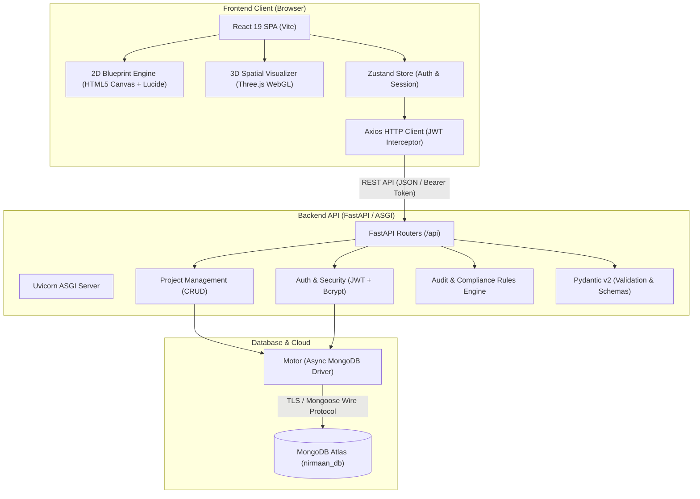
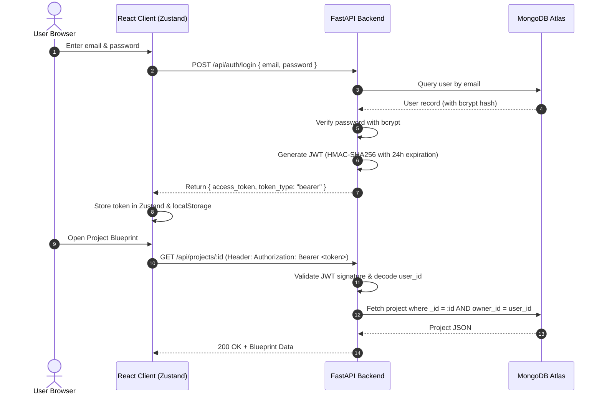

# 🛠️ NIRMAAN 2.0 — Tech Stack & Architecture Specification

> Comprehensive directory of all frameworks, libraries, runtime environments, protocols, and developer tools powering the **NIRMAAN 2.0** architecture platform.

---

## 🏛️ System Architecture Overview



---

## 💻 Frontend Technologies

| Technology | Category | Version | Role in NIRMAAN 2.0 | Key Implementation Files |
| :--- | :--- | :--- | :--- | :--- |
| **React** | UI Framework | `^19.2.8` | Declarative UI layer, modular component rendering, reactive state management | `frontend/src/App.jsx`, `frontend/src/main.jsx` |
| **Vite** | Build Tool / Bundler | `^8.2.0` | Next-generation frontend tooling providing rapid Hot Module Replacement (HMR) and optimized Rollup production builds | `frontend/vite.config.js` |
| **Three.js** | 3D Graphics / WebGL | `^0.185.1` | Renders 3D rooms, dynamic wall extrusions, lighting, shadows, cameras, and material presets (Oak, Concrete, Glass) | `frontend/src/components/Room3DCanvas.jsx` |
| **Zustand** | State Management | `^5.0.14` | Lightweight, unopinionated client state for persistent user authentication tokens and active session info | `frontend/src/store/useAuthStore.js` |
| **React Router** | Client-side Routing | `^7.11.0` | Declarative routing across Landing, Login, Registration, Dashboard, and 2D/3D Editor with route guards | `frontend/src/App.jsx`, `frontend/src/components/ProtectedRoute.jsx` |
| **Axios** | HTTP Client | `^1.19.0` | Promise-based HTTP client featuring automatic JWT `Authorization` header injection via interceptors | `frontend/src/api/client.js` |
| **Tailwind CSS** | Styling System | `^4.3.3` | Utility-first styling engine with `@tailwindcss/vite` integration for rapid responsive layouts and glassmorphic UI | `frontend/src/index.css`, `frontend/src/App.css` |
| **Lucide React** | Iconography | `^1.34.0` | Clean, customizable vector icons for blueprint tools, toolbar actions, compliance badges, and status widgets | `frontend/src/pages/EditorPage.jsx`, `frontend/src/pages/DashboardPage.jsx` |
| **HTML5 Canvas API** | 2D Rendering | Native | Powers the real-time 2D Blueprint grid, wall snapping, door/window placement, and furniture coordinate mapping | `frontend/src/pages/EditorPage.jsx` |

---

## ⚙️ Backend Technologies

| Technology | Category | Version | Role in NIRMAAN 2.0 | Key Implementation Files |
| :--- | :--- | :--- | :--- | :--- |
| **Python** | Language Runtime | `3.10+` (tested on `3.14.5`) | High-performance backend execution environment | `backend/` |
| **FastAPI** | Web Framework | `>=0.100.0` | Modern, fast ASGI web framework for building REST APIs with automatic OpenAPI (Swagger/ReDoc) documentation | `backend/main.py` |
| **Uvicorn** | ASGI Server | `>=0.22.0` | Lightning-fast ASGI web server implementation for Python using `uvloop` and `httptools` | `backend/main.py` |
| **Motor** | Async MongoDB Driver | `>=3.3.0` | Non-blocking, coroutine-based Python driver for MongoDB powered by `PyMongo` and `asyncio` | `backend/database.py` |
| **Pydantic v2** | Data Validation | `>=2.0.0` | High-speed data parsing and validation using Python type hints for requests, responses, and DB models | `backend/auth/schemas.py`, `backend/projects/schemas.py`, `backend/audit/schemas.py` |
| **python-jose** | Token Security | `>=3.3.0` | Cryptographic signing, encryption, and verification of JSON Web Tokens (JWT) using HMAC-SHA256 | `backend/auth/security.py` |
| **passlib & bcrypt** | Password Hashing | `passlib==1.7.4`, `bcrypt==4.0.1` | Enterprise-grade salt-and-hash password security for user authentication | `backend/auth/security.py` |
| **email-validator** | Validation Library | `>=2.0.0` | Validates email syntax and deliverability according to RFC standards during user registration | `backend/auth/schemas.py` |
| **python-dotenv** | Configuration | `>=1.0.0` | Zero-dependency `.env` environment variable loader for backend secrets | `backend/database.py`, `backend/auth/security.py` |
| **Certifi** | SSL / TLS Security | `>=2023.7.22` | Curated collection of Root Certificates to validate SSL/TLS authenticity when connecting to MongoDB Atlas | `backend/database.py` |

---

## 🗄️ Database & Storage

| Component | Technology | Description |
| :--- | :--- | :--- |
| **Database** | **MongoDB Atlas** | Fully-managed cloud NoSQL document database configured with high-availability replica set clustering. |
| **Driver** | **Motor (`AsyncIOMotorClient`)** | Fully asynchronous, event-loop integrated database connection with connection pooling and automated index creation. |
| **Collections** | `users`, `projects` | - `users`: Holds hashed credentials, timestamps, and profiles.<br>- `projects`: Stores 2D/3D blueprints with nested arrays for walls, doors, windows, furniture, metadata, and owner IDs. |
| **Indexes** | Unique & Compound | - Unique index on `users.email`<br>- Index on `projects.owner_id` for fast query filtering |

---

## 🛡️ Authentication & Authorization Workflow



---

## 📐 Algorithmic Engines

### 1. 2D Blueprint Engine
- **Canvas Math**: Euclidean vector calculations for line endpoints `(x1, y1) -> (x2, y2)`.
- **Coordinate Grid**: 20px magnetic snap grid facilitating precise architectural alignment.
- **Parametric Elements**: Walls, single/double doors with directional swing arcs, windows with glazing offsets, and multi-orientation furniture items (Sofas, Beds, Plants, TV consoles).

### 2. 3D Spatial Walkthrough Engine
- **Three.js Extrusion**: Dynamically creates `BoxGeometry` and custom polygon shapes from 2D wall coordinates.
- **Lighting & Ambiance**:
  - `DirectionalLight` simulating exterior sunlight with realistic shadow frustum.
  - `AmbientLight` and `HemisphereLight` providing soft interior fill lighting.
- **Material Shader Presets**:
  - **Oak Wood**: `MeshStandardMaterial` with natural wood hue and soft roughness.
  - **Polished Concrete**: Industrial neutral tone with subtle metallic properties.
  - **Architectural Glass**: `MeshPhysicalMaterial` featuring high light transmission (`0.8`), refraction index (IOR `1.5`), and transparency.

### 3. Compliance & Audit Scoring Engine
- **Pure Functional Core**: Zero external I/O rule engine in [`backend/audit/engine.py`](file:///c:/Users/tejas/OneDrive/Desktop/Nirmaan%202.0/backend/audit/engine.py).
- **Rule Evaluations**:
  - Enclosed Perimeter Wall Verification (minimum 4 perimeter walls).
  - Primary Ingress/Egress Door Checks (minimum 1 door clearance).
  - Exterior Natural Ventilation & Fenestration Rules (window-to-wall ratios).
  - Vastu Shastra Directional Harmony suggestions.
  - Dynamic score calculation bounded strictly between `0` and `100`.

---

## 🧪 Testing & Quality Assurance

| Tool | Focus | Scope |
| :--- | :--- | :--- |
| **pytest** | Unit & Integration Testing | Tests authentication lifecycles, project CRUD ownership barriers, and compliance scoring rules ([`test_audit.py`](file:///c:/Users/tejas/OneDrive/Desktop/Nirmaan%202.0/backend/test_audit.py), [`test_projects.py`](file:///c:/Users/tejas/OneDrive/Desktop/Nirmaan%202.0/backend/test_projects.py)). |
| **Playwright** | End-to-End (E2E) Testing | Validates user sign-in flows, 2D canvas interaction, project creation, and route protections ([`frontend/tests/`](file:///c:/Users/tejas/OneDrive/Desktop/Nirmaan%202.0/frontend/tests)). |
| **oxlint** | Static Analysis / Linting | High-performance JavaScript/JSX linter for fast code quality and syntax enforcement. |

---

## 📦 Summary Table of Dependencies

### Backend Dependencies (`backend/requirements.txt`)
```text
fastapi>=0.100.0
uvicorn[standard]>=0.22.0
motor>=3.3.0
passlib==1.7.4
bcrypt==4.0.1
python-jose[cryptography]>=3.3.0
pydantic[email]>=2.0.0
email-validator>=2.0.0
python-dotenv>=1.0.0
certifi>=2023.7.22
pytest>=8.0.0
```

### Frontend Dependencies (`frontend/package.json`)
```json
{
  "dependencies": {
    "@tailwindcss/vite": "^4.3.3",
    "axios": "^1.19.0",
    "lucide-react": "^1.34.0",
    "react": "^19.2.8",
    "react-dom": "^19.2.8",
    "react-router-dom": "^7.11.0",
    "tailwindcss": "^4.3.3",
    "three": "^0.185.1",
    "zustand": "^5.0.14"
  },
  "devDependencies": {
    "@playwright/test": "^1.62.1",
    "@types/react": "^19.2.17",
    "@types/react-dom": "^19.2.3",
    "@vitejs/plugin-react": "^6.0.4",
    "oxlint": "^1.75.0",
    "vite": "^8.2.0"
  }
}
```

